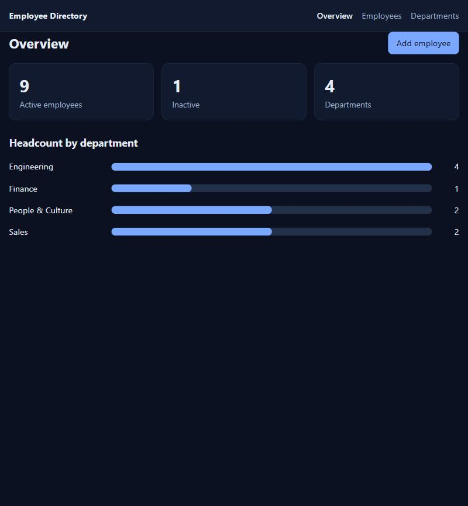
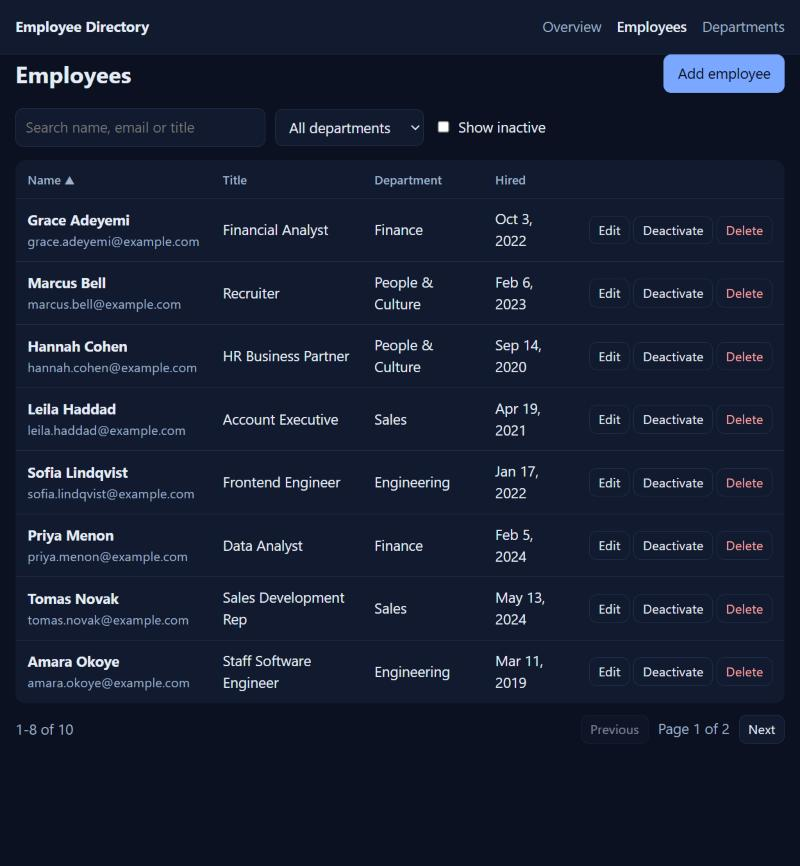

# Employee Directory (Angular + ASP.NET Core minimal APIs)

[](https://github.com/hamzamehmood46/employee-directory-angular-dotnet/actions/workflows/ci.yml)

A full-stack **CRUD** application: an **Angular 22** front end and an **ASP.NET Core 8 minimal-API** back end (EF Core, SQLite). Manage employees and departments, see headcount at a glance, and get **live email-availability feedback** while you type.

| Overview | Employees |
|---|---|
|  |  |

## What it demonstrates

| Area | Details |
|---|---|
| **Async form validation** | The email field asks the API whether an address is free *as you type*: debounced (no request per keystroke), stale checks are cancelled, the employee being edited is excluded so keeping your own email is fine, and a network failure counts as "unknown" rather than "taken" so a flaky connection can't block the form. The API still enforces uniqueness on save. |
| **Reactive forms** | Per-field validation, "not in the future" hire-date rule, server errors (`409`, `400` validation problem details) shown inline. |
| **Server-side list** | Debounced search (name, email, title), department filter, show-inactive toggle, sortable columns, paging, delete with confirmation, and stepping back a page when you delete the last row of one. |
| **Soft delete** | Deactivate and reactivate. Inactive people are hidden by default and included on request. |
| **Dashboard** | Headcount per department as accessible CSS bars (no chart library), linking through to the filtered list via route query params bound as component inputs. |
| **Minimal APIs** | Endpoint groups, DTO records, explicit DataAnnotations validation, RFC 7807 errors, Swagger, CORS. |
| **Modern Angular** | Standalone components, signals and `computed`, `@if/@for` control flow, typed reactive forms. |

## API

| Method | Route | Notes |
|---|---|---|
| GET | `/api/employees?search=&departmentId=&includeInactive=&sort=&dir=&page=&pageSize=` | Paged; sort by `name`, `title`, `department`, `hired`; page size capped at 100 |
| POST / PUT / DELETE | `/api/employees[/{id}]` | Email normalised to lower case and unique; hire date can't be in the future |
| POST | `/api/employees/{id}/deactivate` and `/reactivate` | |
| GET | `/api/employees/email-available?email=&excludeId=` | Used by the form's async validator |
| GET / POST / PUT / DELETE | `/api/departments[/{id}]` | Delete blocked while the department has employees (`409`) |
| GET | `/api/summary` | Active and total headcount per department |

## Run it

You need the **.NET 8 SDK** and **Node.js 22+**.

```bash
# terminal 1: API on http://localhost:5070 (Swagger at /swagger); seeds sample data on first run
dotnet run --project api/src/DirectoryApi --urls http://localhost:5070

# terminal 2: Angular dev server on http://localhost:4200
cd web
npm install
npm start
```

Point the front end at another API by changing the `API_BASE` provider (default `http://localhost:5070/api`); allow another origin on the API with `Cors:Origins`.

## Tests

```bash
dotnet test api                        # 22 integration tests (WebApplicationFactory + real SQLite)
cd web && npm test -- --watch=false    # 43 unit tests (Vitest)
```

- **API:** CRUD, case-insensitive unique email on create *and* update, validation, future hire dates, unknown departments, deactivate/reactivate, search/filter/sort/paging, the email-availability endpoint, summary counts, UTC timestamps, CORS.
- **Angular:** the async validator (debounce, cancellation of stale checks, edit-mode exclusion, network-failure handling), list behaviour, form flows, department management and the dashboard.

## Notes from building it

Tests and real-browser runs surfaced three bugs worth knowing about:

- **Validation silently didn't run.** On a positional C# record, `[Required]` written without a target lands on the constructor parameter, but minimal APIs validate *properties*. Blank names and bad emails were accepted until tests caught it. The attributes now use `[property: ...]`, with a comment explaining why.
- **Timestamps read as the wrong time.** SQLite drops the time zone, so `createdAt` came back without a `Z` and browsers read UTC as local time. A UTC value converter fixes it, with a test on the raw JSON.
- **Sorting by a `decimal`** fails on SQLite (seen in the sibling [inventory app](https://github.com/hamzamehmood46/inventory-manager-angular-dotnet)); not applicable here, but worth remembering when swapping providers.

## Production notes

- Swap SQLite for SQL Server/PostgreSQL and add EF Core migrations instead of `EnsureCreated`.
- Add authentication and authorisation (see [claims-api-dotnet](https://github.com/hamzamehmood46/claims-api-dotnet) and [claims-portal-angular](https://github.com/hamzamehmood46/claims-portal-angular) for a JWT + role-based setup).
- The sample data uses `example.com` addresses; no real people are represented.

## License

MIT
